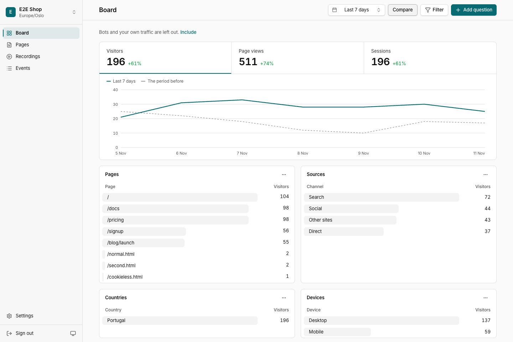

# cf-analytics

**Product analytics that runs in your own Cloudflare account.** Your sites and apps send events with PostHog's own SDKs, unchanged. cf-analytics stores them in the EU, records sessions, draws heatmaps and answers questions from one dashboard.

Moving a product over is a change of host:

```js
posthog.init("<the project's public token>", {
  api_host: "https://e.shop.example.com",
})
```

Each product gets an intake host under its own domain, so a visitor's browser sends to no one else's. A product's server reads its own numbers with a secret key:

```bash
curl https://e.shop.example.com/api/external/query \
  -H "Authorization: Bearer $CFANALYTICS_SECRET_KEY" \
  -H "Content-Type: application/json" \
  -d '{"kind":"trend","measure":"visitors","granularity":"day","range":{"kind":"last_days","days":7}}'
```

cf-analytics is part of [c-f-x](https://github.com/c-f-x), a family of self-hosted tools on Cloudflare.



## What it does

- **Counts visits and events.** It accepts what posthog-js, posthog-node and posthog-ios send, on the paths they send to: `/e/`, `/i/v0/e/`, `/batch/`, `/s/`, `/flags/` and `/array/<token>/config`. A real-SDK suite (`pnpm compat`) runs all three against the Worker.
- **Counts without storing anything on the device.** A cookieless visit gets a server-made id from a salt that is deleted each day.
- **Answers the usual questions.** Trends with breakdowns and a comparison period, top pages, sources, countries and devices, ordered funnels, retention and scroll depth. A visitor is the person when known, else the anonymous id, so anonymous visitors count too.
- **Records sessions and draws heatmaps.** Recordings go to an R2 bucket in the EU and play back in the dashboard with rrweb. Clicks, rage clicks and dead clicks are drawn over a recorded snapshot of the page.
- **Keeps data in the EU for a set time.** Each product has its own SQLite Durable Object in Cloudflare's EU jurisdiction. Events, recordings and heatmap points each have a retention period, and a daily sweep removes what is older. A person can be erased on request, and a product's data exported.
- **Leaves out bots and your own traffic.** Known bots and AI crawlers are marked, and rules you set mark your own visits. Both are left out of every answer unless you ask for them.

## What it does not do

No feature flags, error tracking, surveys or experiments. It does not speak PostHog's query language: questions are asked as JSON, in the shape `packages/shared/src/query.ts` defines. The dashboard has one user, the owner of the Cloudflare account, who signs in with Cloudflare.

## How it works

One Worker holds the intake, the query API and the dashboard. A small D1 database lists the products and their keys. Each product's events, people, recordings index and heatmap points live in that product's own Durable Object, apart from every other product's. A second, small Worker checks the first every five minutes and emails you when it fails.

| Part | Choice |
|---|---|
| Runtime | Cloudflare Workers |
| Storage | One SQLite Durable Object per product, R2 for recordings, D1 for the product list, all in the EU |
| API | Hono |
| Dashboard | React, Vite, Tailwind, Base UI, TanStack Router and Query |
| Tooling | pnpm, TypeScript, Biome, oxlint, Vitest on the real Workers runtime |

## Run your own

You need a Cloudflare account on Workers Paid, a zone for the dashboard's host, and Node 24 or later.

1. Create the resources `docs/operations.md` lists: the D1 database and R2 bucket in the EU jurisdiction, the bucket's lifecycle rule, the watcher's KV namespace and a private OAuth client for sign-in. There is no install command yet.
2. Copy `site.example.jsonc` to `cf-analytics.jsonc` in a private folder outside this repository, and fill in your account id, hostnames, resource ids and addresses. Point `CFX_SITE` at that folder.
3. Deploy. Every command prints its plan and how to undo each step, and changes nothing without `--go`:

```bash
pnpm install
pnpm ops secrets production --go
pnpm ops deploy production --go
pnpm ops watch --go
pnpm smoke production
```

`pnpm ops backup`, `restore` and `export` copy your data out and back. `docs/operations.md` covers each command.

## Develop

```bash
pnpm install
pnpm check      # lint, typecheck, tests, size tests and builds, stopping at the first failure
pnpm compat     # the real PostHog SDKs against the Worker under wrangler dev
pnpm e2e        # every dashboard screen, in light and dark
```

Tests are written from `docs/spec/behaviours.md` before the code, and each names the behaviour it proves. They run on the real Workers runtime with real Durable Objects, D1 and R2, and nothing of our own is mocked.

| Doc | Read it for |
|---|---|
| `docs/architecture.md` | The parts, slices, flows and dependency rules |
| `docs/data-model.md` | Every store, its lifetime, and the schema steps |
| `docs/operations.md` | Resources, commands, health and alerts |
| `docs/decisions.md` | Decisions and their reasons |
| `docs/engineering.md` | How code is written and tested, and the check behind each rule |
| `docs/spec/posthog-protocol.md` | What the PostHog SDKs send and expect, read from their source |
| `docs/donors.md` | Which open-source projects the ideas came from |

## Credits

cf-analytics is our own code, built on ideas and tests from these MIT projects, each read at a pinned commit (`docs/donors.md`):

- [traks](https://github.com/shivamanupadi/traks), for period and time-zone maths and the daily visitor hash
- [InsightFlare](https://github.com/RavelloH/InsightFlare), for bot marking, the funnel planner and the architecture check
- [flarelytics](https://github.com/kalle-works/flarelytics), for SQL templates with table-driven tests
- [Counterscale](https://github.com/benvinegar/counterscale), for its query tests

It also stands on:

- [PostHog](https://github.com/PostHog/posthog-js)'s SDKs, whose wire protocol it accepts. The Worker serves posthog-js's own lazy scripts, unchanged, under their licence (`THIRD_PARTY_NOTICES.md`).
- [rrweb](https://github.com/rrweb-io/rrweb), which plays the recordings.
- [isbot](https://github.com/omrilotan/isbot), which spots bots.
- cfmail, whose dashboard components and design tokens the dashboard reuses (`THIRD_PARTY_NOTICES.md`).

## Support

[](https://buymeacoffee.com/jahala)

## License

MIT. Third-party code the repository carries keeps its own notice in `THIRD_PARTY_NOTICES.md`.
